



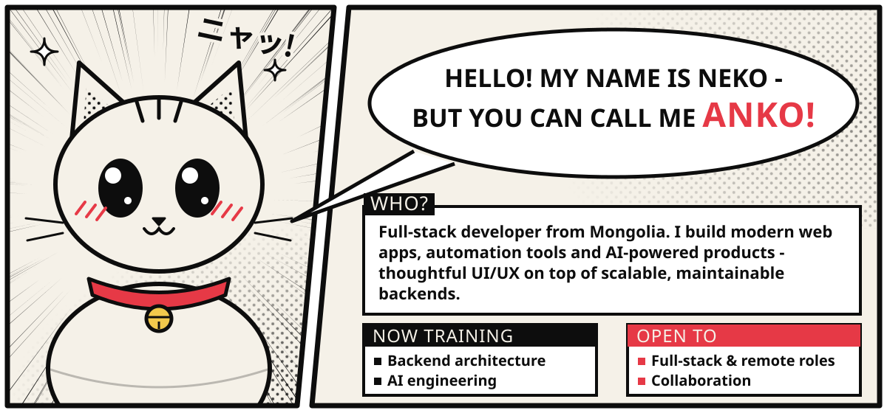


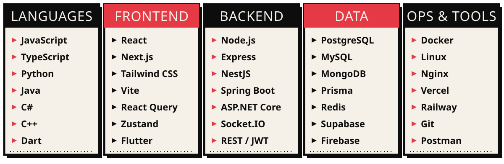




  <a href="https://github.com/imjustneko/QuitSmokeWeb">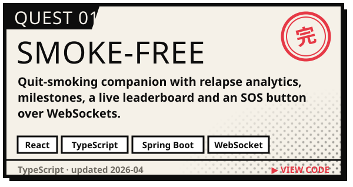</a>
  <a href="https://github.com/imjustneko/TaskProject">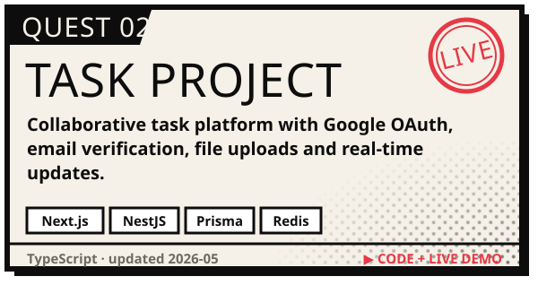</a>
  <a href="https://github.com/imjustneko/School-Calendar-System">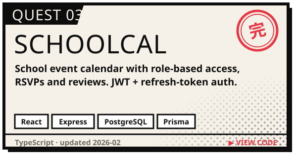</a>
  <a href="https://github.com/imjustneko/Travel-web">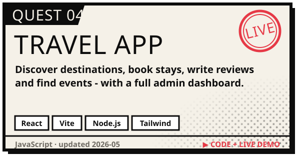</a>
  <a href="https://github.com/imjustneko/ForMeow">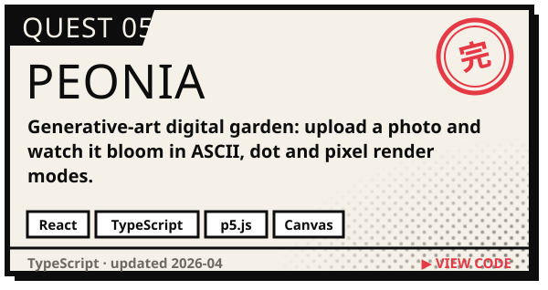</a>
  <a href="https://github.com/imjustneko/Game-Design-Document-Web">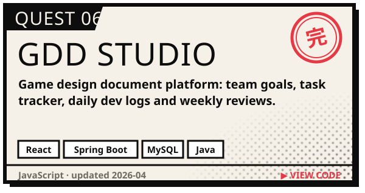</a>

  <b>▶ Live demos:</b>
  <a href="https://task-project-nu-sand.vercel.app">TaskProject</a> ·
  <a href="https://travel-web-mu-one.vercel.app">Travel App</a>


  



